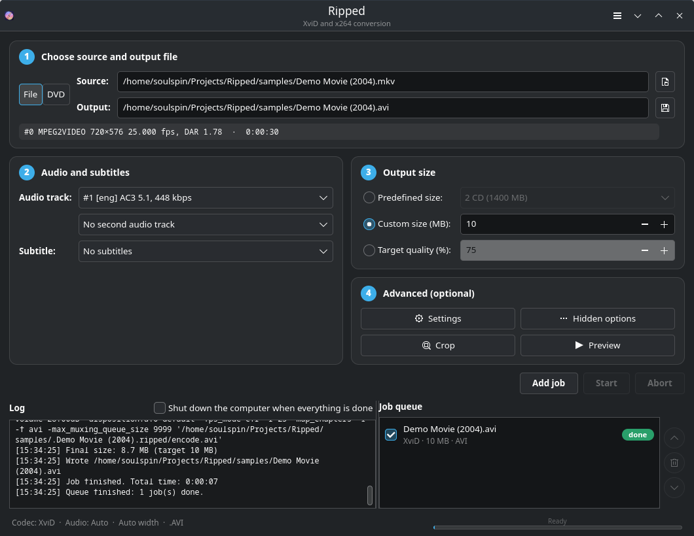
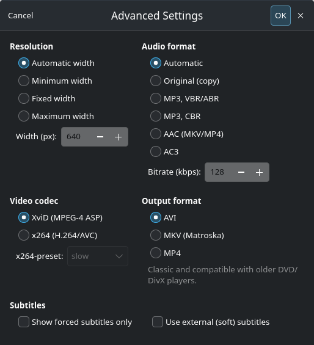
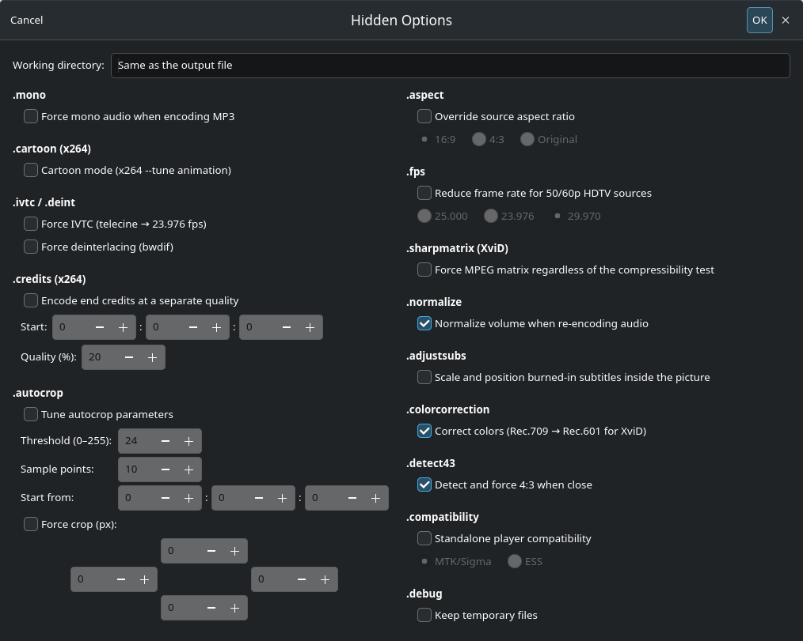
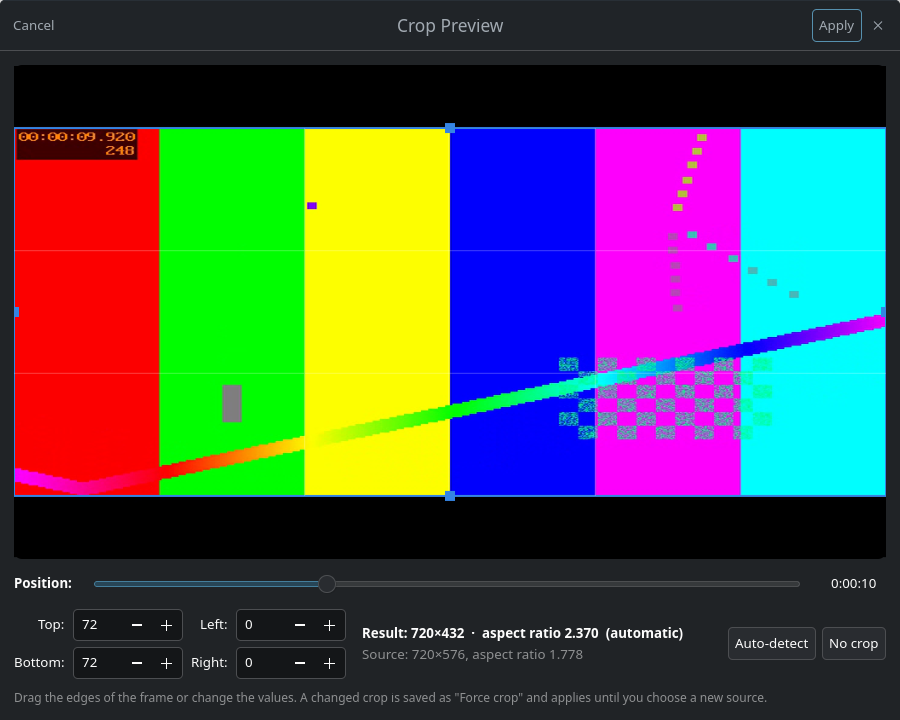

<p align="center">
  
</p>

<h1 align="center">Ripped</h1>

<p align="center">
  <b>DVD and video to XviD / x264 – the AutoGK way, on modern Linux.</b><br>
  Version 0.1.1
</p>

<p align="center">
  
</p>

## A small tribute to AutoGK

Back in the 2000s, **Auto Gordian Knot** by len0x was *the* way to turn a DVD into an XviD
file that fit on one or two CDs. You picked a source, a size and maybe an audio track, pressed
Start, and AutoGK took care of the rest. It handled the demuxing, interlace detection, cropping,
the compressibility test, resizing and two-pass encoding, and the result was usually better
than anything you could have tuned by hand.

Ripped is a small tribute to that program. It keeps the four-step workflow, the predefined
sizes and the "hidden options", and rebuilds the whole pipeline on **ffmpeg** with a **GTK 4**
interface for today's Linux desktops. XviD is still here for nostalgia and old standalone
players, and **x264** is right next to it.

Ripped is an independent project. It is not affiliated with AutoGK or its author and contains
no code from it. The original's workflow was studied from its documentation and from the
strings in the shipped binary.

## Features

- **The AutoGK workflow:** source → audio/subtitles → output size → advanced → *Start*.
- **XviD and x264** (libxvid / libx264). Two-pass for a target size, single pass for a
  target quality.
- **Size presets in AutoGK style:** ¼–3 CD, ⅙–½ DVD-R, FAT32 max, DVD-R, DVD-R DL, or a custom
  size in MB. The 2 and 3 CD presets are split into 700 MB parts at keyframes;
  a custom size always gives one file.
- **Automatic analysis:**
  - Interlace/telecine detection with IVTC or deinterlacing.
  - Black-border autocrop.
  - AutoGK-style **compressibility test** that picks the largest width your size budget can
    really afford.
- **Live bitrate estimate:** see the video bitrate your size, audio and container choices
  leave for the encoder, before you add the job.
- **Crop preview:** see the detected crop on real frames, scrub through the movie and drag the
  edges yourself.
- **Audio:** keep the original track, or use MP3 (ABR/CBR), AAC or AC3. Up to two tracks,
  downmixing and peak normalization.
- **Subtitles:** burn in text or bitmap subtitles (SRT/ASS/VobSub/PGS), optionally forced
  only, or keep them as soft tracks.
- **Containers:** AVI, MKV or MP4. MKV keeps chapters, multiple audio tracks and soft subtitles.
- **DVD input:** unencrypted `VIDEO_TS` folders and ISO images, with title selection (the
  main movie is pre-selected).
- **Job queue:** batch encode, restored between sessions, with a log file per job, a desktop
  notification and an optional shutdown when everything is done.
- **Preview in mpv** (or ffplay) with the crop, deinterlacing and resize applied.

## Screenshots

| Advanced settings | Hidden options |
|---|---|
|  |  |

**Crop preview**



## Requirements

- Python 3.11+
- GTK 4.10+ and PyGObject (with pycairo)
- ffmpeg/ffprobe built with `libxvid`, `libx264` and `libmp3lame`. DVD input also needs the
  `dvdvideo` demuxer (ffmpeg 7.0+ with libdvdnav/libdvdread).
- Optional: `mpv` for the preview (falls back to `ffplay`)

| Distribution | Install |
|---|---|
| Arch / CachyOS / Manjaro | `sudo pacman -S python-gobject python-cairo gtk4 ffmpeg mpv` |
| Debian / Ubuntu | `sudo apt install python3-gi python3-gi-cairo gir1.2-gtk-4.0 ffmpeg mpv` |
| Fedora | `sudo dnf install python3-gobject python3-cairo gtk4 ffmpeg mpv` (ffmpeg from RPM Fusion) |

Ripped checks at startup whether your ffmpeg has the required encoders and tells you what is
missing.

## Running and installing

Run it straight from the source tree:

```sh
git clone https://github.com/soulspin/Ripped.git
cd Ripped
./bin/ripped                     # or: ./bin/ripped "My Movie.mkv"
```

Install it for your user, with a menu entry and icon:

```sh
./install.sh                     # installs to ~/.local
./install.sh --uninstall
PREFIX=/usr/local sudo -E ./install.sh   # system-wide
```

## How it works

| AutoGK 2.55 (Windows)               | Ripped (ffmpeg)                                         |
|-------------------------------------|---------------------------------------------------------|
| DGIndex + VobSub (demux/index)      | `dvdvideo` demuxer → remux to Matroska (cached)         |
| Decomb `IsCombed` analysis          | `idet` at 12 sample points                              |
| Telecide + Decimate (IVTC)          | `fieldmatch` + `bwdif` (hybrid) + `decimate`            |
| LeakKernelDeint                     | `bwdif`                                                 |
| autocrop.dll                        | `cropdetect` at 10 sample points, union, mod-4 size     |
| ColorMatrix Rec.709 → Rec.601       | `colormatrix=bt709:bt601` (HD sources → XviD)           |
| SelectRangeEvery compressibility test | `select` 15 of every 300 frames at reference quality |
| LanczosResize / soft BicubicResize  | `scale` lanczos / bicubic (0, 0.5) below 60 %           |
| XviD VfW 2-pass via VirtualDubMod   | libxvid / libx264 2-pass with an automatic correction pass |
| LAME ABR 128 / Azid / Normalize     | libmp3lame ABR, downmix, `volumedetect` + `volume`      |

**Compressibility test.** Ripped encodes 5 % of the movie, 15 frames out of every 300, at a
reference quality (XviD quantizer 2, or x264 CRF 18). It then compares the real video bit
budget with the projected full size at that quality. With automatic width it chooses the
largest width, in steps of 16 px, where the predicted compressibility stays at about 70 % for
XviD or 65 % for x264. Below 60 % it switches to a softer resizer, just like AutoGK did.
"Target quality 67 %" means roughly XviD Q3, as in the original.

**Target size.** After the second pass, Ripped checks the size of the video part. If it missed
the target by too much (over by more than 0.5 %, or under by more than 7 %), it corrects the
bitrate and runs the second pass again.

## Keyboard shortcuts

| Key | Action |
|---|---|
| Ctrl+O / Ctrl+S | Choose source / output file |
| Ctrl+U, Ctrl+F8 | Choose / toggle external subtitle file |
| Ctrl+E, Ctrl+F9 | Advanced settings, Hidden options |
| Ctrl+B, Ctrl+P | Crop preview, Preview in mpv |
| Ctrl+Enter, Ctrl+R, Ctrl+. | Add job, Start, Abort |
| Ctrl+↑/↓, Ctrl+D | Move job, Remove job |

## Known limitations (v0.1)

- **Encrypted DVDs are not supported**, just like in AutoGK. Rip to an unencrypted folder
  first.
- **The DVD path has not been tested against a real disc yet.** It is built on ffmpeg's
  `dvdvideo` demuxer. Reports are very welcome.
- **The credits zone and cartoon mode only work with x264.** ffmpeg's libxvid wrapper exposes
  neither XviD zones nor cartoon mode.
- **ffmpeg cannot write VobSub (idx/sub).** Soft bitmap subtitles for AVI are saved as a
  `.mks` sidecar instead. Use MKV to keep them in the same file.
- **HDR sources are not tone-mapped.**
- **The interface is English only.**

## Credits

- **len0x**, for Auto Gordian Knot and many years of painless encodes.
- **FFmpeg**, **XviD**, **x264** and **LAME**, which do all the real work.

## License

GPL-2.0-or-later. See [LICENSE](LICENSE).
